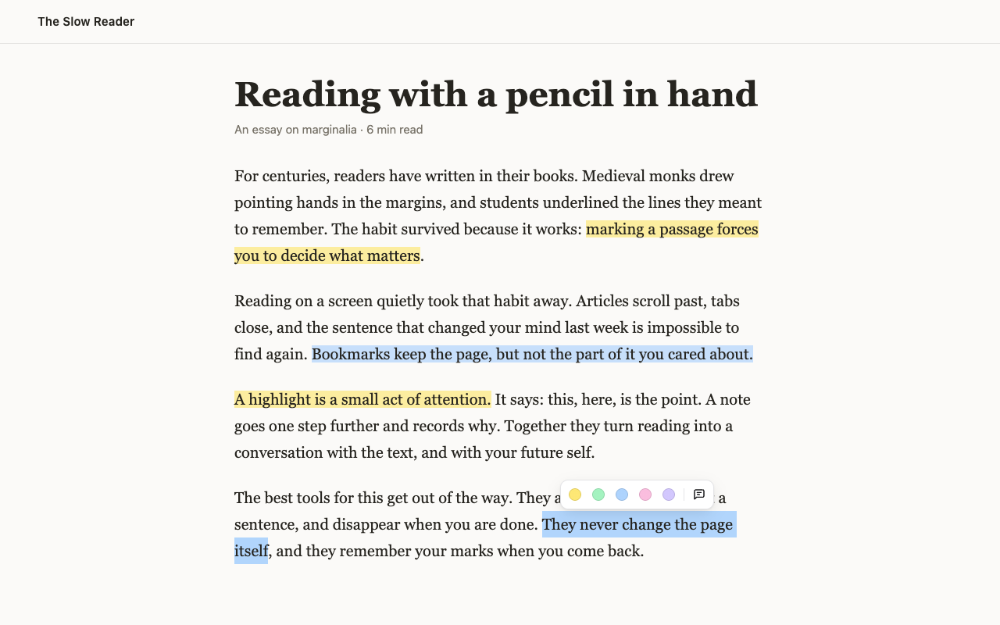

**penciled for the browser** brings penciled to every website you read. Select text to highlight it or add a note, and your highlights come back when you return to the page.

It's free and [open source](https://github.com/marcellosso/penciled/tree/main/apps/extension), with no account to create. Your highlights are saved in your browser and never sent anywhere: see the [privacy statement](/extension/privacy/).

## Install

penciled is on its way to the **Chrome Web Store**, **Edge Add-ons** and **Firefox Add-ons**. Until it's listed, you can install it in Chrome or Edge from GitHub:

1. Download `penciled-<version>-chrome.zip` (or `-edge.zip`) from the [latest extension release](https://github.com/marcellosso/penciled/releases?q=extension&expanded=true), and unzip it.
2. Open `chrome://extensions` (or `edge://extensions`) and turn on **Developer mode**.
3. Click **Load unpacked** and choose the unzipped folder.

It works in Chrome, Edge and other Chromium browsers, version 123 or later, and in Firefox 140 or later, including Firefox-based browsers like Zen. Firefox only installs extensions signed by Mozilla, so for Firefox, wait for the Firefox Add-ons listing.

## Using it

- **Highlight:** select text and pick a color in the toolbar. Click a highlight to change its color, add a note or remove it.
- **This page's highlights:** click penciled's toolbar button to list them. Click one to scroll to it. The same menu turns penciled off for the whole site.
- **The sidebar:** keeps your highlights open beside the page as you read. **This page** follows the tab you're on, and **All pages** searches everything. Open it with the sidebar button in penciled's menu or <kbd>Alt</kbd>+<kbd>Shift</kbd>+<kbd>N</kbd>, or make penciled's toolbar button open it in the settings.
- **All your notes:** the notes page lists every highlight from every site, with search. Open it from the toolbar button's **All notes** link.
- **Keyboard:** <kbd>Alt</kbd>+<kbd>A</kbd> moves into the toolbar, <kbd>Alt</kbd>+<kbd>]</kbd> and <kbd>Alt</kbd>+<kbd>[</kbd> move between highlights, <kbd>Alt</kbd>+<kbd>Shift</kbd>+<kbd>H</kbd> hides or shows highlights on a tab, and <kbd>Alt</kbd>+<kbd>Shift</kbd>+<kbd>N</kbd> opens or closes the sidebar. On a Mac, <kbd>Alt</kbd> is <kbd>⌥</kbd>.
- **Settings:** choose the toolbar's theme, what penciled's toolbar button opens, turn off opening the toolbar on every selection, edit or add colors, and see the sites penciled is off on.

## Keep a backup

Highlights are stored only in the browser you made them in, and uninstalling penciled deletes them. To keep a copy, or to move them to another browser, use **Export a backup** on the notes page, then **Import a backup** in the other browser. **Export as Markdown** gives you a readable copy for your notes app.

## What it can't do yet

- Highlight text inside frames, such as embedded posts, or in PDFs.
- Highlight inside text fields and other editable areas, which it leaves alone.
- Sync highlights between computers. Your settings do sync, through your browser account.

When a page changes so much that penciled can't be sure where a highlight belongs, it doesn't guess: the highlight is listed as **Couldn't find this on the page**, so you can still read or delete it. See [Anchoring](/guides/anchoring/) for how this works.

Found a bug or missing something? [Open an issue](https://github.com/marcellosso/penciled/issues).
